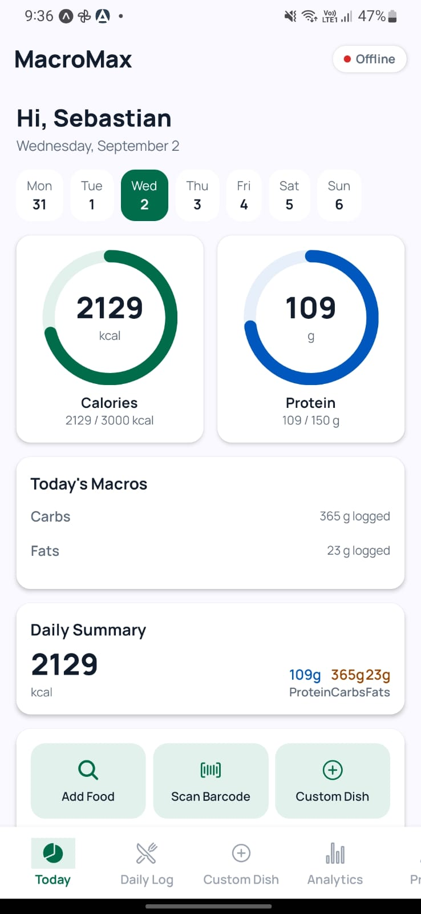
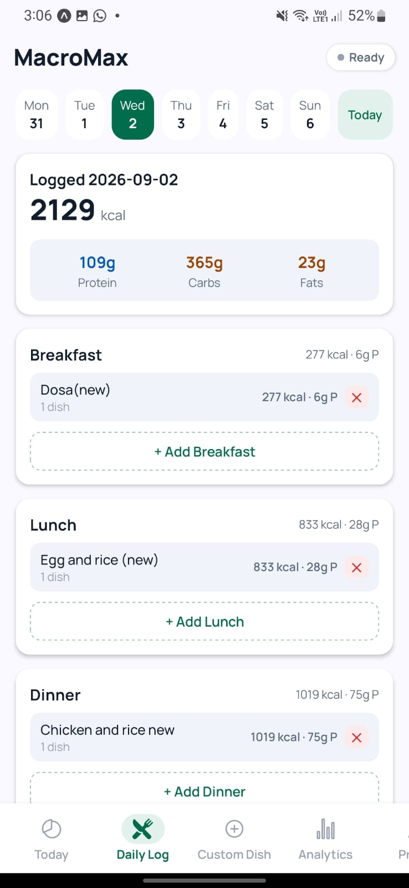
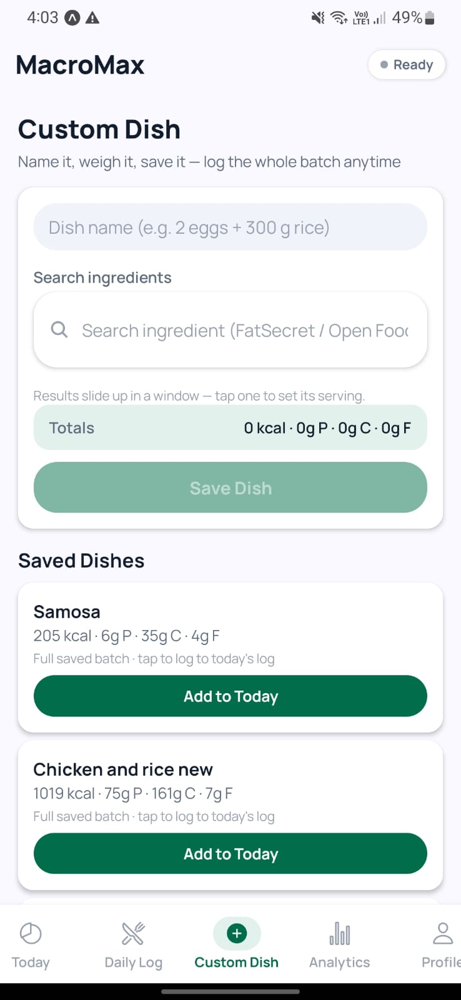
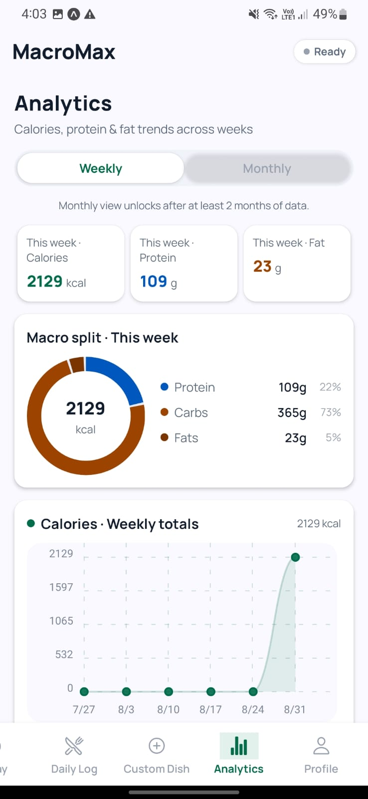
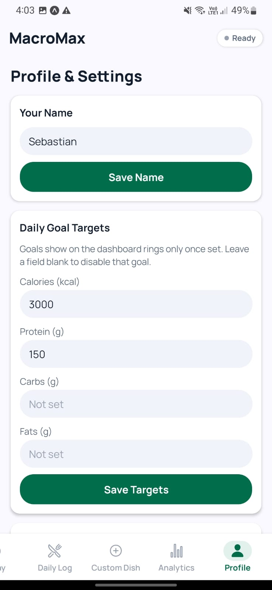

# MacroMax

[](https://github.com/sebastian2006-dev/MacroMax/actions/workflows/ci.yml)

**An offline-first macro & nutrition tracker for Android.**

Built natively with React Native (Expo SDK 57), TypeScript strict mode and NativeWind — no account, no cloud: every byte of user data lives in an on-device SQLite database that survives app updates, with one-tap JSON backup/restore for moving devices.


---

## Table of Contents

- [Screenshots](#-screenshots)
- [Features](#features)
- [Architecture](#architecture)
- [Tech Stack](#tech-stack)
- [Getting Started](#getting-started)
- [Environment Variables](#environment-variables)
- [Data Providers](#data-providers)
- [Testing](#testing)
- [CI](#ci)
- [Project Structure](#project-structure)

---

## 📱 Screenshots

| Today's Overview | Daily Log | Custom Dish Builder |
| :---: | :---: | :---: |
|  |  |  |

<div align="center">

&nbsp;&nbsp;&nbsp;

**Analytics Dashboard** &nbsp;&nbsp;&nbsp;&nbsp;&nbsp;&nbsp;&nbsp;&nbsp;&nbsp;&nbsp;&nbsp; **Profile & Settings**

</div>

---

## Features

### First run

- **3-step onboarding** — name → daily goals (with a prominent *Set it later / Skip*) → a 3-slide walkthrough of Search / Log / Track. The completion flag lives in SQLite: it survives app updates and never replays unless app data is cleared.

### Tracking

- **Today's Overview** dashboard with animated goal rings (Calories · Protein) in the brand's high-contrast chart palette, plus low-intake nudges (time-gated, never naggy) and fat-limit warnings
- **Daily Log** for managing meals across Breakfast, Lunch, Dinner and Snacks/Extra, with **Lock & Save Day** — a locked day refuses further edits so reviewed totals can't drift
- **Custom Dish** builder — name a dish, pick ingredients + servings, save it as a one-tap loggable batch
- **Weekly strip** with logged-day dots and day-switching; ring animations re-fill per day
- **Time-aware greeting card** — hour-calibrated buckets (morning / midday / afternoon / evening / night) with a rotating phrase per bucket

### Food search

- Barcode scanning via `expo-camera` → **Open Food Facts V2** product endpoint
- Text search via **FatSecret Platform API** (OAuth 2.0, raw ingredients & dishes) + **Open Food Facts** (packaged products)
- **3-tier pipeline**: bundled SQLite ingredient database (FTS5, 8,379 foods from IFCT 2017 + USDA) → on-device cache → remote APIs, with strict relevance ranking applied identically at every tier
- **Debounced** input (~350 ms) — the pipeline fires once the user stops typing, never per keystroke
- Serving-aware logging: grams, pieces/units (egg, roti, banana…), and provider **standard portions** (including ml-based servings)

### Analytics

- Swipeable per-macro trend pages (calories / protein / carbs / fats) with **daily and monthly windows**, self-calibrating Y axes (headroom above the peak, never clipped), readable date labels and honest captions
- Macro-split donut with period totals and per-macro percentages
- Rolling 7-day averages per metric

### Data ownership

- **Export backup** — the entire dataset (logs, meals, recipes, goals, name, prefs) as pretty-printed JSON via the Android share sheet (Files, Gmail, Drive…)
- **Import backup** — pick a file, review a summary of what it contains, confirm, and restore in a single all-or-nothing transaction; the app then offers a reload
- Every table validated and sanitized on import — malformed rows are dropped, numbers coerced, hostile files rejected with a human-readable error

### Design system

- Light **"Emerald Ring"** theme built from the logo's own palette, with WCAG-checked contrast enforced by unit tests (bright hues fill, deep `.ink` siblings carry text)
- Tablet-aware layouts (600dp breakpoint: capped card widths, scaled type, comfy text measures)
- Manrope typeface, soft shadows, mint gradient CTAs

---

## Architecture

```
┌──────────────────────────────  app/ (Expo Router)  ─────────────────────────────┐
│  (tabs): Today · Log · Recipe · Analytics · Settings      login · search · scan │
└──────────────┬──────────────────────────────────────────────────┬──────────────┘
               │ hooks (useAuth, useProfile, useDailyLog, …)       │
┌──────────────▼──────────────────────────────────────────────────▼──────────────┐
│  src/lib — pure, unit-tested core                                                │
│   nutrition · trendSeries · servingUnits · greeting · walkthrough · backupData   │
│   api (3-tier search) · fatSecret · openFoodFacts · fallbackFoods · seedDb      │
└──────────────┬───────────────────────────────────────────────────────────────────┘
               │
┌──────────────▼───────────────────────────────────────────────────────────────────┐
│  src/lib/db.ts — ONE SQLite database (macromax.db) in FileSystem.documentDirectory│
│  profile · daily_logs · meal_items · custom_recipes · recipe_ingredients          │
│  food_cache · user_prefs (key/value) · WAL · FK on · day-locking · backup I/O     │
└───────────────────────────────────────────────────────────────────────────────────┘
```

**Storage is SQLite-only.** The user database lives at `<FileSystem.documentDirectory>/db/macromax.db`, which Android preserves across app updates (and only removes on uninstall). Identity (name), onboarding/walkthrough flags and every goal sit in the same file as the food logs — the `user_prefs` key/value table replaced AsyncStorage entirely, and the package is no longer a dependency. A bundled read-only ingredient database (`assets/seed.db`, FTS5) feeds Tier 1 of search and is never written at runtime.

---

## Tech Stack

| Layer | Technology |
| --- | --- |
| Framework | React Native 0.86 / Expo SDK 57 |
| Routing | Expo Router (custom gradient tab bar) |
| Language | TypeScript (`strict: true`) |
| Styling | NativeWind (Tailwind) + semantic theme tokens |
| Storage | **expo-sqlite** (user data + prefs) + bundled FTS5 seed DB |
| Animation | react-native-reanimated (UI-thread ring fills) |
| Charts | `react-native-chart-kit` + hand-rolled SVG (rings, donut) |
| Native integrations | expo-camera, expo-file-system, expo-sharing, expo-document-picker, expo-updates (reload-after-restore) |
| Lint / Test | ESLint 9 (eslint-config-expo) · Node built-in test runner via tsx |

---

## Getting Started

### Prerequisites

- Node.js 24 and npm
- An Android device or emulator
- For the dev client: Android SDK (or use Expo Go for UI-only work — note the SQLite/shared/picker flows need a build)

### Installation

```bash
npm install
cp .env.example .env   # add your FatSecret keys (text search)
npm start
```

### Building a dev client / APK

```bash
npx expo run:android                # dev client (recommended)
# release APK:
npx expo prebuild
cd android && ./gradlew assembleRelease
```

Useful scripts:

```bash
npm run build:db      # rebuild assets/seed.db from scripts/inputs CSVs
npm run build:icons   # regenerate launcher/splash art from the canonical logo
npm run ci            # lint + typecheck + tests (what CI runs)
```

---

## Environment Variables

| Variable | Required | Description |
| --- | --- | --- |
| `EXPO_PUBLIC_FATSECRET_CLIENT_ID` | For text search | FatSecret Platform API client ID |
| `EXPO_PUBLIC_FATSECRET_CLIENT_SECRET` | For text search | FatSecret client secret — keep out of release binaries (see `.env.example`) |
| `EXPO_PUBLIC_FATSECRET_REGION` | No | Result region, e.g. `IN` |
| `EXPO_PUBLIC_OFF_USER_AGENT` | Recommended | Descriptive Open Food Facts User-Agent |

The app degrades gracefully without keys: local tiers (seed DB, cache, fallback list) still answer searches.

---

## Data Providers

| Flow | Provider | Notes |
| --- | --- | --- |
| Tier 1 (offline) | Bundled `assets/seed.db` (FTS5) | 8,379 foods — IFCT 2017 + USDA, quality-deduped, energy-gated |
| Tier 2 (offline) | `food_cache` table | Every past lookup, replayed instantly |
| Tier 3 (online) | FatSecret Platform API | OAuth 2.0 client credentials; standard portions (g & ml) |
| Tier 3 (online) | Open Food Facts | V2 product endpoint (barcode) + search API |
| Last resort | Built-in reference list | Searches never hang empty |
| Ordering | Unified 3-tier relevance sort | Tier 1 raw/basic → Tier 2 cooked/prepared → Tier 3 complex dishes |

---

## Testing

**314 / 314 unit tests passing** plus lint (`--max-warnings 0`) and strict `tsc --noEmit`. Tests exercise the **real modules** — pure logic, no native or network dependencies — so they verify actual app behaviour rather than copies of it.

```bash
npm test           # run all unit tests
npm run lint       # eslint, zero warnings allowed
npm run typecheck  # strict TypeScript check (app + tests)
npm run ci         # everything CI runs
```

| Suite | Tests | What it ensures |
| --- | --- | --- |
| Nutrition engine | 57 | Macro math, goal mapping + **goal-input parsing** (blank/junk/clamps), default-goal resolution, alerts (fats = limit, not goal), date helpers, rolling averages, meal grouping |
| Search pipeline (`api`) | 51 | Dedupe (barcode → externalId → source+name), cache eligibility & row mapping, 3-tier relevance sorting, local-first sufficiency policy |
| Serving units | 50 | Piece-size rules, grams conversion, quantity parsing, portion multipliers, pluralisation |
| Trend series & axes | 24 | Daily/monthly bucketing, year rollover, headroom axis ceilings that never clip the peak, tick formatting |
| Greeting calibration | 17 | Full 24-hour bucket table, boundary flips, the no-lunch-in-morning regression, tiling, Ionicons glyph existence |
| HTTP helpers | 16 | Numeric coercion, RFC-4648 base64 for OAuth |
| Offline fallback DB | 15 | Substring search, macro values, result shape |
| Backup payload | 14 | Round-trip serialization, hostile-input sanitization, version guarding, summary lines |
| FatSecret mapping | 14 | Description parsing, per-100g derivation, ml portions, rejection of unusable foods |
| Theme contrast (WCAG) | 12 | Every text/background pair ≥ AA, chart hues visible on light **and** dark fields, the "never white-on-mint" guard |
| Sync-status store | 12 | Header pill modes, pub/sub |
| Open Food Facts | 10 | Per-100g/per-serving mapping, kJ→kcal, portions, rejection rules |
| Ring palette | 9 | Hue-family + pairwise-separation guards, track = own-color tint, `withAlpha` clamping |
| Tab-bar layout | 7 | Geometry vs font scale; labels never truncate at 100–300% |
| Debounce | 6 | Trailing-edge semantics, cancel/flush, burst collapse |

---

## CI

GitHub Actions (`.github/workflows/ci.yml`) runs on every push to `main`/`feature/**` and every PR targeting `main`:

1. **Lint → Type-check → Test** — one sequential gate (`npm run ci`), Node 24, npm-cached.
2. **Metro bundle smoke check** — after the gates pass, `expo export` compiles the Android bundle so an unresolvable import (a red-screen-on-device class of bug that typecheck can't see) fails CI instead of your phone.

The README badge above always reflects the latest `main` run.

---

## Project Structure

```text
app/                    # Expo Router screens ((tabs): index=Today, log, recipe, analytics, settings; login, search, scanner)
components/             # UI: MacroRing, MacroDonut, WeekStrip, DynamicGreeting, AddFoodSheet, ServingInput, sheets, tab bar
src/lib/                # Pure core: db (SQLite), nutrition, trendSeries, greeting, walkthrough, backup(Data), api, providers
src/lib/seedDb.ts       # Tier-1 bundled FTS5 ingredient database
src/hooks/              # useAuth, useProfile, useDailyLog, useFoodSearch, useWeekLoggedDates…
src/theme/              # Emerald Ring tokens (colors, shadows, typography) — WCAG-tested
src/types/              # Shared TypeScript types
assets/seed.db          # Bundled ingredient database (rebuilt via npm run build:db)
test/                   # 314 unit tests (Node test runner + tsx)
scripts/                # build-db.js (seed builder), generate-android-icons.js
.github/workflows/      # CI (lint → typecheck → test → bundle smoke check)
```
